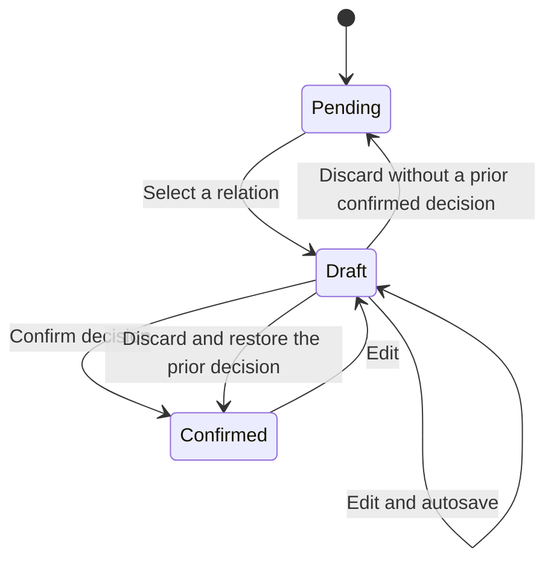

# Annotation Workflow

## Unit of Work

Annotators classify **reply relations between messages** according to codebook 1.1. This tool does not classify toxicity. An interval contains targets that require a decision and context needed to interpret them. Each item in the left-hand list is a sampled window, not an entire channel.

The source being annotated remains explicit in the editor. Links point from the source to strictly earlier antecedents visible in the same interval, channel, and server. A target may reply to zero, one, or several messages. Context messages may be antecedents, but are not sources requiring a human decision.

Saving a draft enables recovery. Confirming updates the graph and history. Exports always use the confirmed snapshot.

## Available Decisions

| State | Interpretation | Human links | Graph effect |
| --- | --- | --- | --- |
| `pending` | The decision has not been confirmed | None | Blocks validation |
| `complete` | The antecedent list has been reviewed | Zero or more | Non-ambiguous links connect messages |
| `no_reply` | No reply relation was identified | None | Does not claim a conversation start |
| `outside_context` | A likely antecedent is outside the package | None | Preserves an observational limitation |
| `ambiguous` | The evidence does not support a decision | None | Preserves uncertainty |
| `new_conversation` | Explicit judgment that a new conversation starts | None | Includes the source as a singleton component if isolated |

`complete` with zero edges remains valid under the protocol. The tool does not convert it to `no_reply` or `new_conversation`. Selecting edges sets the source state to `complete`; remove them to choose a no-link decision.

Each link can also be marked ambiguous: it is preserved but excluded from default connectivity. High/medium/low confidence records human assessment, not a model probability. Uncertainty about an additional antecedent is an operational extension separate from the persisted annotation schema.

## Native Discord Replies

`native_reply_to_message_id` is imported evidence. When available, the interface shows the author, text, and reference. **Inspect** and **Locate** do not change labels. **Add as antecedent** changes only the draft. Confirmation remains explicit.

If the reference is outside the interval, its ID is shown without inventing content. References to the source itself, later messages, or messages from another channel/server are ineligible as antecedents. Later replies in the package may help interpret the continuation; they are not antecedents of the source.

## Interval Stages

| Stage | Question | Completion |
| --- | --- | --- |
| Annotate messages | Which earlier messages does this source reply to? | Confirm each target |
| Review conversations | Did the links produce coherent groups? | Review every component |
| Validate interval | Are there pending decisions, drafts, or links to review? | Complete the checklist and validate |
| Export | Which session version should enter analysis? | Local results with a manifest |

Global review requires no pending sources, no open drafts, and a valid review of every component. Ambiguity and missing context may remain recorded: artificially removing them would manufacture certainty.

Editing can merge or split conversations and invalidate affected reviews. Those components must be reviewed again. Validating an interval does not assert that conversations begin or end inside the package.

## Sessions and Adjudication

Annotators and sessions retain independent decisions. Comparison is explicit and reports decisions, links, and groupings over separate eligible sets; pending and unresolved states are not implicit negatives.

Adjudication creates a third session and records its base sessions and revisions. No decision is copied automatically. Each adjudicated source requires a rationale. Changed base sessions require a new adjudication. Adjudicated gold requires completed bases and global validation.

## Interpreting Results

`summary.csv` contains counts from the confirmed snapshot. `summary.json` adds IDs, revision, type, and release status. `drafts_excluded` counts drafts excluded from labels; `ambiguous_edges` counts uncertain edges, not undetermined sources. `components` counts observed components, not complete corpus conversations.

Summaries are not population estimates. Sampling weights and probabilities remain in the participation tables for downstream analysis. The tool does not change the sampling, codebook, or original materializer.
