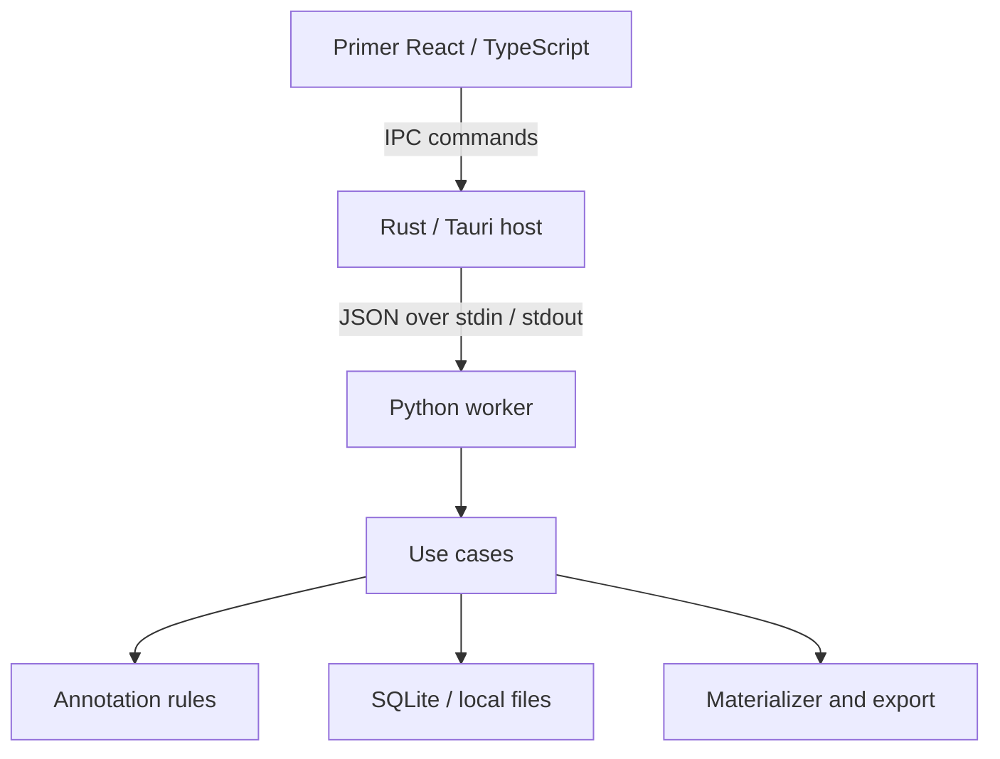

# Desktop Architecture

## Architectural Decision

The application runs entirely on the researcher's computer, with a desktop window and results compatible with the existing pipeline. Version 0.3 uses Tauri 2 and Rust for native integration and reuses the scientific Python processor. Scientific decisions do not depend on the window, and no view accesses SQLite, Parquet, or the file system directly.

The desktop path does not start an HTTP server or application port and does not use a remote account or automatic updater. The application does not download messages, media, or models during use. Development and build setup are separate and may download dependencies.



## Responsibilities

| Layer | Main files | Responsibility |
| --- | --- | --- |
| Native window | `src-tauri/src/main.rs` | Authorized commands, native dialogs, workspace configuration, and shutdown |
| Supervisor | `src-tauri/src/worker.rs` | Process lifecycle, request sequencing, responses, and timeouts |
| React root | `src/main.tsx` | Primer ThemeProvider, BaseStyles, and bundled theme styles |
| Transport / types | `src/transport.ts`, `src/types.ts` | Typed Tauri IPC to the existing Python worker |
| Controller | `src/model.ts` | Observable state, serialized drafts, navigation, lifecycle, and use cases |
| Presentation | `src/App.tsx`, `src/Annotation.tsx`, `src/Stages.tsx` | Primer layouts, messages, editor, review, comparison, and adjudication |
| Dialogs | `src/Dialogs.tsx`, `src/labels.ts` | Primer dialogs, native file selection, English labels and guidance |
| Frontend build | `vite.config.ts`, `scripts/Build-Frontend.ps1` | Type checking and Vite assets in `dist`, embedded by Cargo |
| Protocol | `app/worker.py` | JSON pipes, workspace lock, and structured errors |
| Use cases | `app/application.py` | Unified dispatch, asynchronous imports, and configuration |
| Service | `app/service.py` | Sessions, transactional confirmation, revisions, and comparison |
| Domain | `app/domain.py` | Decision validation, graph, signatures, and metrics |
| Persistence | `app/storage.py` | SQLite, transactions, backups, and compressed payloads |
| I/O | `reader.py`, `exporting.py`, `vendor/` | Corpus compatibility and canonical materialization |

The former imperative JavaScript presentation has been replaced by React and TypeScript. `AppModel` exposes an external store consumed by React's `useSyncExternalStore`; React owns DOM updates. Primer controls provide interaction, accessibility, and visual states. `PageLayout` provides native Primer resizing with keyboard support and persisted widths. Custom CSS handles message content and layout using Primer color/spacing tokens. System light/dark themes are bundled locally. No remote fonts, scripts, or style CDNs are required.

## Internal Contract, Version 1

Rust accepts only the methods listed in `METHODS`. The frontend cannot send shell commands. Opening an output folder requires that it be inside the active workspace.

```json
{"id":12,"method":"state","params":{"session_id":"example-session"}}
{"id":12,"ok":true,"result":{"session":{},"messages":[],"decisions":{}}}
```

Each line is a UTF-8 JSON object. `id` is a protocol counter; Discord IDs remain strings. Errors use `ok:false` and `error:{kind,message}`. The worker reserves stdout for the contract; library output goes to stderr. The host does not log message content.

Queries: `config`, `imports`, `windows`, `state`, `sessions`, `compare`, `history`, `job`. Mutations: `import`, `demo`, `open_session`, `cursor`, `draft`, `discard_draft`, `confirm`, `undo`, `redo`, `review_component`, `review_interval`, `export`, `backup`. `ensure_idle` and `shutdown` control lifecycle.

The controller maps its operation names to the typed worker protocol in `src/transport.ts`. No HTTP routes or server are part of the production artifact. Vite's optional development server serves frontend assets only and cannot replace Tauri IPC.

## Persistence and Concurrency

- SQLite uses WAL and FULL synchronous writes. The schema remains at version 1.
- Confirmation validates the state, checks `expected_revision` and `expected_draft_updated`, writes the decision/edges/event, and increments the revision in one transaction.
- Drafts are persisted separately and do not modify the confirmed graph.
- Conversation reviews use a signature of content and relations. Only affected reviews are invalidated.
- An operating-system file lock prevents two desktop workers from using the same folder. It is released when the process exits, including after a failure. The lock file may remain without indicating an active lock.
- The host serializes calls per worker. Imports run as an internal task and return a `job_id` for progress checks.
- Close any previous application instance before opening the same workspace during migration.

## Lifecycle and Recovery

On close, Rust intercepts the request and notifies the interface. The interface blocks new edits, saves any pending draft, and requests shutdown. An active import prevents normal closure. If saving fails, the window stays open and offers explicit retry or discard options for changes not yet written.

Requests are limited to 2 MiB, with a five-minute response timeout. A timeout or invalid protocol stops the flow: writes are not retried automatically because a confirmation may already have been persisted. Reopen the application and inspect the saved state. The worker exits when stdin closes; on normal shutdown, the host also reaps the child process.

When switching folders, the interface saves the draft; the host checks that the current workspace is idle and starts the new worker before replacing the old one. The selection is persisted in `desktop.json` under the application configuration directory. If the new folder cannot be opened, the current workspace remains active.

## Distribution and Limitations

`Cargo.lock` pins Rust dependencies; `package-lock.json` pins frontend dependencies. `Start-Desktop.ps1` and `Build-Desktop.ps1` explicitly type-check and build React before invoking Cargo (direct Cargo commands do not execute Tauri CLI build hooks). Tauri CLI hooks are also configured for developers using that CLI. `Build-Desktop.ps1` compiles a release build and uses PyInstaller in directory mode. The native executable embeds `dist` HTML/CSS/JS; `worker` contains the scientific runtime. Node.js is needed only for development/builds, not on the target machine. The database, sample, and exports are not included.

The supplied build targets **Windows x64**. Other platforms require adapting the scripts, native file picker, and distribution. Portability to other platforms has not been verified. The frontend uses WebView2; it is not a pure Rust widget interface.

References: [Tauri commands](https://v2.tauri.app/develop/calling-rust/), [configuration](https://v2.tauri.app/reference/config/), and [Windows prerequisites](https://v2.tauri.app/start/prerequisites/). The artifact behavior is specified in `ARTIFACT_SPEC.md`; annotation semantics remain in codebook 1.1.
